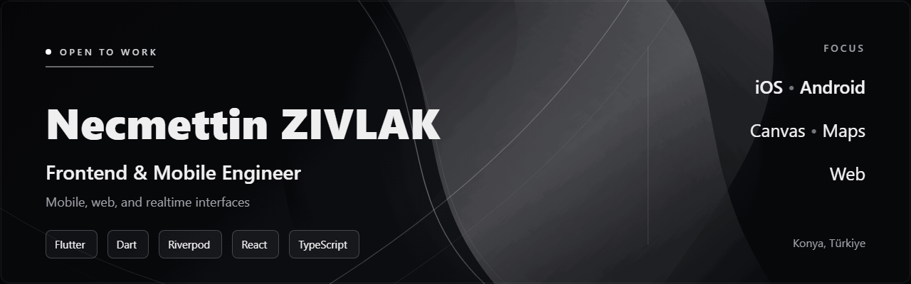

  

Flutter engineer looking for the next product role. Four years shipping iOS, Android, and web — trading interfaces, live maps, and operational tools. React, Next.js, and TypeScript sit next to Flutter, not in front of it.

[Website](https://necmettinzivlak.com) · [LinkedIn](https://www.linkedin.com/in/necmettinzivlak) · [Email](mailto:zivlaknecmettin@gmail.com)

---

Open to Flutter and product engineering roles. Most recent work was a trading app at SadaApex, and before that fleet and workforce systems at Yerlem. Based in Konya. Turkish native, English at a professional working level.

## Experience

**SadaApex** · Frontend & Mobile Developer · Sep 2025 — Oct 2026

Production iOS and Android app for realtime crypto technical analysis. Flutter, Riverpod, Clean Architecture.

- Custom Canvas chart engine: pan, zoom, dynamic crosshair, 80+ indicators, 90+ drawing tools
- Spot and futures streams over WebSocket from Binance, Bitget, and Bybit
- Liquidation heatmaps, funding-rate scanners, large-trade flow, long/short ratios, Hyperliquid whale analysis

**Yerlem Location Technologies** · Frontend & Mobile Developer · Jul 2023 — Sep 2025

Enterprise web and mobile products for workforce, fleet, payments, and live telemetry. React, TypeScript, Flutter.

- Map interfaces that follow hundreds of vehicles and field staff at once
- Delivery across nine products: Ulak, Tahsildar, Acun, Pusula, İyekut, Kimlik, Fuel, İlgen, Pamir

**Stechome** · Frontend & Mobile Developer · Nov 2022 — Mar 2023

Responsive product UI for commerce, hiring, and community platforms. Berlin Esnaf, Getjob, Buhara Baharat, Demir Yıldızı.

**Terra Software** · Frontend Intern · Aug 2022 — Oct 2022

Umay, a corporate student-tracking interface. Yolbars, live-map tools for drawing and managing transport routes.

## Practice

| | |
|---|---|
| Mobile | Flutter, Dart, Riverpod, React Native, Clean Architecture |
| Web | React, Next.js, TypeScript, Vite, Redux Toolkit, Zustand, Tailwind |
| Live data | Canvas engines, WebSocket, Mapbox, Leaflet, Google Maps |
| Services | Node.js, Express, PostgreSQL, REST, Docker, GitHub Actions |

## Education

**Anadolu University** — Management Information Systems, B.Sc. · 2023 — 2026

**Konya Technical University** — Computer Programming, A.Sc. · 2021 — 2023

---

Available now. Best fit is a Flutter product team, with room for realtime UI, maps, and web.
