  

  <!-- Hızlı Bağlantı Rozetleri -->
  
  
  

    

  

    <b>Frontend & Mobile Engineer</b> crafting high-frequency interfaces, custom Canvas engines, and live telemetry systems. 
    Four years shipping production software across <b>iOS, Android, and Web</b> — from realtime crypto technical analysis at <b>SadaApex</b> to enterprise fleet & workforce platforms at <b>Yerlem</b>.
  

<!-- Animasyonlu 3'lü Bento Mühendislik Vitrini -->

  

  

## ⚡ Engineering Experience

<table>
  <tr>
    <td width="75%">
      <h3><b>SadaApex</b> · Frontend & Mobile Developer</h3>
      
<i>Production iOS and Android application for realtime cryptocurrency technical analysis.</i>

      <ul>
        <li><b>Custom Canvas Chart Engine:</b> Engineered from scratch with pan, zoom, dynamic crosshair, <b>80+ technical indicators</b>, and <b>90+ interactive drawing tools</b> at 60fps.</li>
        <li><b>Low-Latency Market Streams:</b> Integrated high-throughput Spot and Futures WebSocket streams from <b>Binance, Bitget, and Bybit</b>.</li>
        <li><b>Advanced Orderflow Tooling:</b> Built liquidation heatmaps, funding-rate scanners, large-trade flow trackers, long/short ratios, and <b>Hyperliquid whale analysis</b> modules.</li>
      </ul>
    </td>
    <td width="25%" align="right" valign="top">
      <code>Sep 2025 — Oct 2026</code>  
      
      
      
      
      
    </td>
  </tr>
  <tr>
    <td width="75%">
      <h3><b>Yerlem Location Technologies</b> · Frontend & Mobile Developer</h3>
      
<i>Enterprise web and mobile ecosystem for workforce management, fleet monitoring, payments, and live telemetry.</i>

      <ul>
        <li><b>Spatial & Live-Map Interfaces:</b> Architected map-driven dashboards tracking hundreds of vehicles and field personnel simultaneously in real time.</li>
        <li><b>Multi-Product Delivery:</b> Led frontend and mobile delivery across <b>nine enterprise products</b>: <i>Ulak, Tahsildar, Acun, Pusula, İyekut, Kimlik, Fuel, İlgen, and Pamir</i>.</li>
      </ul>
    </td>
    <td width="25%" align="right" valign="top">
      <code>Jul 2023 — Sep 2025</code>  
      
      
      
      
    </td>
  </tr>
  <tr>
    <td width="75%">
      <h3><b>Stechome Software</b> · Frontend & Mobile Developer</h3>
      
<i>Responsive product UI and client platforms across e-commerce, recruitment, and community networks.</i>

      <ul>
        <li>Delivered end-to-end web and mobile interfaces for <i>Berlin Esnaf, Getjob, Buhara Baharat, and Demir Yıldızı</i>.</li>
      </ul>
    </td>
    <td width="25%" align="right" valign="top">
      <code>Nov 2022 — Mar 2023</code>  
      
      
    </td>
  </tr>
  <tr>
    <td width="75%">
      <h3><b>Terra Software</b> · Frontend Developer Intern</h3>
      
<i>Corporate student-tracking and live transportation routing systems.</i>

      <ul>
        <li>Built UI components for <b>Umay</b> (student tracking) and live-map route drawing/management tools for <b>Yolbars</b>.</li>
      </ul>
    </td>
    <td width="25%" align="right" valign="top">
      <code>Aug 2022 — Oct 2022</code>  
      
      
    </td>
  </tr>
</table>

  

## 🛠️ Technical Practice & Architecture

<table>
  <tr>
    <th align="left" width="22%">Domain</th>
    <th align="left" width="78%">Technologies & Core Competencies</th>
  </tr>
  <tr>
    <td><b>📱 Mobile Engineering</b></td>
    <td>
      
      
      
      
      
    </td>
  </tr>
  <tr>
    <td><b>🌐 Web Ecosystems</b></td>
    <td>
      
      
      
      
      
      
      
    </td>
  </tr>
  <tr>
    <td><b>📡 Realtime & Spatial</b></td>
    <td>
      
      
      
      
      
    </td>
  </tr>
  <tr>
    <td><b>⚙️ Services & DevOps</b></td>
    <td>
      
      
      
      
      
    </td>
  </tr>
</table>

  

## 🎓 Education & Languages

<table>
  <tr>
    <td width="50%" valign="top">
      <b>Anadolu University</b> 
      Bachelor of Science in Management Information Systems 
      <code>2023 — 2026</code>
    </td>
    <td width="50%" valign="top">
      <b>Konya Technical University</b> 
      Associate Degree in Computer Programming 
      <code>2021 — 2023</code>
    </td>
  </tr>
  <tr>
    <td colspan="2">
      <b>Languages:</b> Turkish <i>(Native)</i> · English <i>(Professional working proficiency)</i>
    </td>
  </tr>
</table>

 

  <b>Available now.</b> Best fit is a Flutter or Frontend product team with room for realtime UI, custom Canvas rendering, maps, and web architecture.

